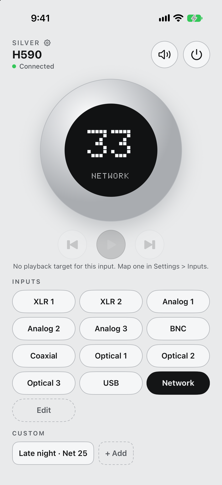
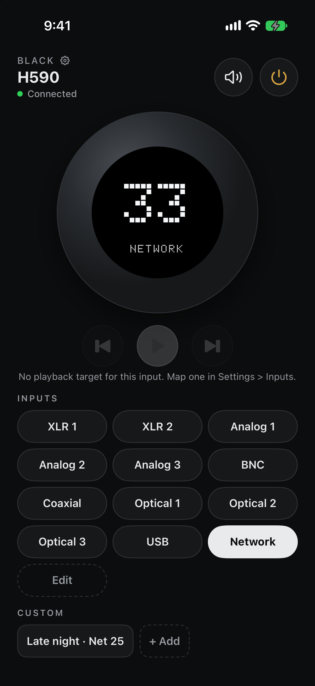
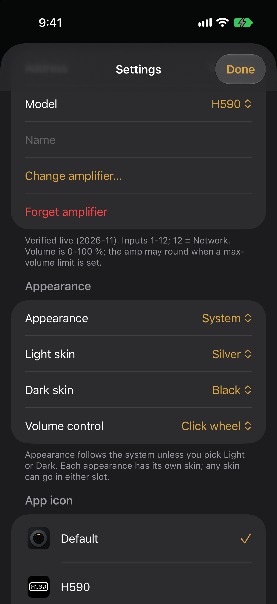

# hegel-remote

An open-source remote for Hegel amplifiers that support IP control (TCP port 50001): iPhone and Mac, SwiftUI,
plus Siri / Shortcuts. Built around the H590.

> Unofficial. Not affiliated with, endorsed by or supported by Hegel Music Systems AS. "Hegel" and model names are
> used only to describe compatibility. No Hegel artwork or logos are used.

| Light: Silver skin | Dark: Black skin | Settings: Appearance and App icon |
|---|---|---|
|  |  |  |

## What it does
- Finds the amp on the LAN (Bonjour, confirmed on port 50001) or takes an IP; remembers it; picks the model
  (H590 verified; H390/H190/H120/H95/Röst listed as untested).
- Power, volume (iPod-style click wheel or a slider), Vol −/+, mute, input selection. Live state: the amp
  broadcasts every change (front panel, RC8, other apps), so the readout follows them.
- Inputs can be renamed and disabled; each can be mapped to a **playback target** for the Prev / Play / Next row
  (Plexamp's player API, or the Mac's media keys). The Hegel protocol itself has no transport commands.
- Custom buttons: a label plus an ordered list of actions (amp commands, HTTP requests for e.g. Home Assistant).
- Skins are data (Silver, Black, OLED built in; paste your own JSON in Settings). The skin follows the system
  theme: Settings > Appearance is System / Light / Dark, with a **light skin** and a **dark skin** (defaults Silver
  and Black; any skin can go in either slot). A single skin chosen in an older version is used for both.
- App icon: a neutral default (Silver Dial; Black Dial in dark mode; a monochrome version for iOS tinted mode) and
  a per-model alternate (H590: a badge with the model name in a dot-matrix font), chosen in Settings > App icon.
  By default the icon follows the amp model (Settings > Model); pick one by hand under App icon to stop that.
- Siri / Shortcuts via App Intents: "Turn off the amp in hegel-remote", "Mute the amp in hegel-remote", "Switch
  the amp to Pontus in hegel-remote", set volume, volume up/down. They work with the app closed.
- Mac: a window plus a menu bar extra showing the volume with a popover remote.

### Icons

`python3 -I scripts/make_icon.py` (Pillow) regenerates every icon under `App/Assets.xcassets`; the output is
committed and deterministic.

| Asset | What | Used by |
|---|---|---|
| `AppIcon` | iOS light / dark / tinted + the Mac sizes | both apps (Finder, Home Screen, Dock when not running) |
| `AppIcon-H590` | alternate iOS icon, light and dark | `UIApplication.setAlternateIconName("AppIcon-H590")` |
| `DockIcon-{Default,H590}-{Light,Dark}` | 1024 px images on the Mac rounded plate | `NSApp.applicationIconImage` at runtime |

On the Mac the Finder and the Dock show the default icon while the app is not running; only a running app can
change its Dock image. iOS shows a system alert on every alternate-icon change.

**Adding a model icon** (for example H390), three places:
1. `scripts/make_icon.py`: add `"H390"` to `MODELS` (digits 0-9 and H, V exist in `GLYPHS`; add a glyph for any other
   letter), then run the script and commit the PNGs and asset catalogs it writes.
2. `Sources/HegelRemoteCore/IconChoice.swift`: add `"H390"` to `AppIcons.availableModelIcons`.
3. `project.yml`: list the set in the iOS target's `ASSETCATALOG_COMPILER_ALTERNATE_APPICON_NAMES`
   (space-separated: `AppIcon-H390 AppIcon-H590`).

**Trademark note.** The model badges draw the model name as plain descriptive text in our own 5x7 dot-matrix font.
They never use Hegel's wordmark, logo or typeface, and the app stays "unofficial" (see the notice at the top).

Design and layering: `Docs/architecture.md`. Wire protocol and live findings: `Docs/protocol.md`.

## Build

Requirements: Xcode 16+ (developed with Xcode 26.6), macOS 14+, [XcodeGen](https://github.com/yonaskolb/XcodeGen)
(`brew install xcodegen`). The project file is generated and not tracked.

```sh
git clone https://github.com/islee/hegel-remote && cd hegel-remote
xcodegen generate                 # writes HegelRemote.xcodeproj from project.yml
open HegelRemote.xcodeproj
```

Schemes: **HegelRemote** (iOS app + unit tests in the simulator) and **HegelRemoteMac** (Mac app, product
`hegel-remote.app`, + the same unit tests on the Mac).

Command line, no signing (simulator / build check):

```sh
swift test                                                                     # HegelKit + HegelRemoteCore
xcodebuild -scheme HegelRemote    -destination 'generic/platform=iOS Simulator' build CODE_SIGNING_ALLOWED=NO
xcodebuild -scheme HegelRemoteMac -destination 'platform=macOS'                 build CODE_SIGNING_ALLOWED=NO
xcodebuild test -scheme HegelRemoteMac -destination 'platform=macOS' CODE_SIGNING_ALLOWED=NO              # 59 Core tests
xcodebuild test -scheme HegelRemote -destination 'platform=iOS Simulator,name=iPhone 17' CODE_SIGNING_ALLOWED=NO  # same tests, simulator
```

The Core tests are the same files under `swift test`, the Mac test bundle and the simulator bundle. On the
development Mac (Xcode 26.6, iOS 26.5/18.6 simulators) the simulator run fails with "The test runner hung before
establishing connection" for every project, including a two-file hello-world one; the Mac destination and `swift test`
are unaffected. If you hit it too: `xcrun simctl shutdown all`, erase the device, retry.

### Signing with a free Apple developer account
`project.yml` leaves `DEVELOPMENT_TEAM` empty on purpose. In Xcode: select the `HegelRemote` target → *Signing &
Capabilities* → tick *Automatically manage signing* and pick your Personal Team; repeat for `HegelRemoteMac`. If the
bundle id `io.github.islee.hegelremote` is taken under your account, change `PRODUCT_BUNDLE_IDENTIFIER` in
`project.yml` (and `.mac` for the Mac target) and regenerate. Alternatively, without touching the file:

```sh
xcodebuild -scheme HegelRemote -destination 'generic/platform=iOS' -allowProvisioningUpdates \
  DEVELOPMENT_TEAM=XXXXXXXXXX build
```

Nothing here needs a paid capability: no App Groups, iCloud, push or SiriKit entitlement.

### Sideload to an iPhone
1. Plug the phone in, enable Developer Mode (Settings → Privacy & Security → Developer Mode), trust the Mac.
2. In Xcode choose the phone as the run destination for the `HegelRemote` scheme and press Run.
3. First launch: Settings → General → VPN & Device Management → trust your developer certificate.
4. Allow *Local Network* access when asked (needed for Bonjour and the amp).

**Free-account limits:** the provisioning profile expires after **7 days**; after that the app stops launching until
you connect the phone and Run again from Xcode (re-sign). A free team can also hold at most 10 app ids per week and
3 installed apps at a time. Siri phrases are registered on first launch of each signed build.

### Run the Mac app
Run the `HegelRemoteMac` scheme in Xcode, or build and copy `hegel-remote.app` from the products folder to
`/Applications`. The menu bar extra appears next to the clock; the window is in the Dock as usual.

## Develop without the real amplifier
`swift run fakeamp` starts an H590 emulator on `127.0.0.1:50001` (power on, input 12, volume 33, broadcasting
every change like the real amp). In the iOS simulator or the Mac app enter `127.0.0.1` in *Or enter the address*.
`--advertise` adds a Bonjour record so discovery finds it from this Mac (it also shows a bogus "H590" in every
AirPlay picker on the LAN while running, so it is off by default). `--port <n>` changes the port; the app accepts
`host:port`.

Screenshots in `Docs/screenshots/` are made with `Docs/screenshots/make.sh` against `fakeamp`.

Never point tests at a real amplifier: `swift test` and the app tests start their own `FakeAmp` on loopback.
`hegelctl --host <ip> --no-keepalive status` is the only read-only check against a live amp.

## Project layout
```
Package.swift, Sources/, Tests/   Swift package: HegelProtocol (Linux-portable), HegelClient, HegelDiscovery, hegelctl,
                                  HegelFakeAmp + fakeamp (development only), HegelRemoteCore (the apps' logic layer)
                                  and their tests                                 -> Sources/README.md
project.yml                       XcodeGen spec for the apps (HegelRemote iOS, HegelRemoteMac, HegelRemoteTests)
App/                              SwiftUI sources shared by both apps: Views/, Intents/, Resources/Fonts/
Docs/                             protocol.md, architecture.md, design/canvas (concepts), screenshots/
```

## Troubleshooting
- **"Unreachable, retrying…"**: the amp sleeps its TCP stack only when mains power is off; check the IP and that
  the phone is on the same Wi-Fi. The amp allows several clients at once, so the Hegel app or a web app running
  elsewhere is fine.
- **Mac media keys do nothing**: macOS may require Accessibility access for hegel-remote before posted key events
  reach other apps (System Settings → Privacy & Security → Accessibility).
- **Plexamp row disabled**: map the input to Plexamp in Settings → Inputs → the input → Playback target.
- **Siri does not know the phrases**: launch the app once after installing; say the phrase with "in hegel-remote".

## Licence
Apache-2.0 (see `LICENSE`). Doto font: SIL Open Font License 1.1 (`App/Resources/Fonts/Doto-OFL.txt`).
